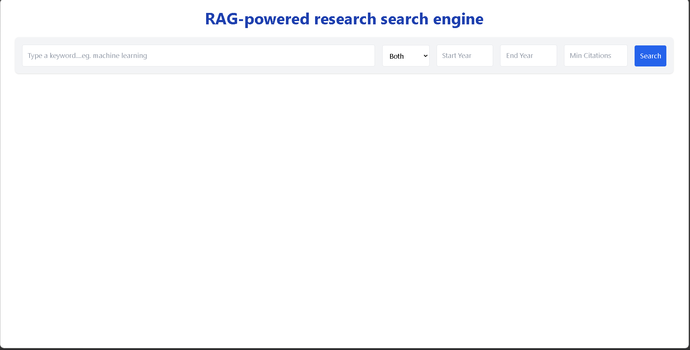

# AI-Powered Semantic Search & Research Analytics Platform

## 📝 Project Overview
An AI-powered search and analytics engine for indexing, retrieving, and summarizing patents and research papers using vector similarity search, cross-encoder reranking, and Retrieval-Augmented Generation (RAG). Users can run natural language queries, apply metadata filters, inspect publication/sub-topic trends, ingest documents with recursive chunking, and generate contextual summaries using a local LLM via Ollama.

## ✨ Key Features
- **Semantic Search & Real-Time Ingestion:** Vector search over `all-MiniLM-L6-v2` embeddings in Milvus (`POST /search`), plus chunked document ingestion (`POST /ingest`) and health checks (`GET /health`).
- **Recursive Chunking & Parent Deduplication:** Splits long text with overlap while preserving metadata, and deduplicates reranked chunks by parent document so one document doesn't crowd out top results.
- **Two-Stage Retrieval + Reranking:** Combines Milvus vector retrieval (`IVF_FLAT`, `L2`) with cross-encoder reranking (`cross-encoder/ms-marco-MiniLM-L-6-v2`).
- **Metadata Filtering:** Filter by document type (`paper`, `patent`, or `both`), citation count threshold, and field of research.
- **Trend & Sub-Topic Analytics:** Tracks publication year distributions by sub-topic and visualizes trends in Nuxt.js with Chart.js.
- **Local RAG Summaries:** Generates grounded summaries from top-ranked results using Ollama without recurring paid LLM API costs.

## 🧠 RAG & Search Pipeline
```text
Query / Ingest Request (FastAPI)
  ├── /ingest ──▶ Recursive Chunking ──▶ Embeddings (all-MiniLM-L6-v2) ──▶ Milvus Insert
  └── /search ──▶ Query Embedding ──▶ Milvus Filtered Vector Search
                      │
                      ▼
             Cross-Encoder Reranking
                      │
                      ▼
             Parent Document Deduplication
                      │
            ┌─────────┴─────────┐
            ▼                   ▼
   Trend Aggregation     RAG Summary (Ollama)
            │                   │
            └─────────┬─────────┘
                      ▼
             Nuxt.js Frontend UI
```

---

## 📸 UI Previews & Screenshots

### Frontend Dashboard & Filters


### Search Results & RAG Summaries


### Sub-Topics Trend Analytics


# 🛠️ Technology Stack

| Layer | Tools |
|------|------|
| Backend API | FastAPI, Uvicorn, Pydantic |
| Vector & Storage | Milvus (Docker), MinIO |
| Embeddings & Reranking | Sentence Transformers (all-MiniLM-L6-v2), Cross-Encoder (ms-marco-MiniLM-L-6-v2) |
| Analytics & LLM | Scikit-learn, Ollama (local LLM) |
| Frontend | Nuxt.js (Vue 3), Tailwind CSS, Chart.js |

---

# 📁 Project Structure

```text
search-platform/
├── backend/
│   ├── app/
│   │   ├── main.py
│   │   ├── chunking.py
│   │   ├── reranker.py
│   │   ├── rag_service.py
│   │   ├── data_ingestion.py
│   │   └── fetch_openalex.py
│   ├── venv/
│   ├── Dockerfile
│   └── .dockerignore
├── frontend/
│   ├── pages/
│   ├── components/
│   └── Dockerfile
├── docker-compose.yml
├── requirements.txt
├── docs/
└── README.md
```

# ⚙️ Running Locally:

#### Start Milvus + MinIO
###### From the project root run:
        docker-compose up -d

---

#### 1️⃣ Backend Setup & Run

    cd backend
    python -m venv venv
    venv\Scripts\activate
    pip install -r requirements.txt

---
## Ingest sample datasets (run from backend/):

#### Data Ingestion

    python app/data_ingestion.py

This will:

- Process research datasets
- Generate embeddings
- Insert vectors into Milvus

---

#### Start the FastAPI server (run from backend/):
    uvicorn app.main:app --reload

#### Backend runs on:
    API runs at http://localhost:8000 (interactive docs at http://localhost:8000/docs).
---

## 2️⃣ Frontend Setup & Run
    cd frontend
    npm install
    npm run dev

## UI runs at:
    http://localhost:3000
---

---

# 🔎 Example Queries

| Query | Doc Type | Expected Output |
|------|------|------|
| machine learning | Papers | AI/ML research papers |
| injection molding machine | Patents | Manufacturing patents |
| film | Both | Patents and papers on films |

---

---
# 🚀 Deployment & Known Limitations

| Component | Current Setup |
|----------|------------|
| Frontend | Vercel ([https://search-platform-five.vercel.app/](https://search-platform-five.vercel.app/)) |
| Backend API | Local (uvicorn); public cloud hosting not yet deployed |
| Vector DB & Storage | Docker (Milvus, MinIO) |
| LLM | Ollama (local) |

## Mobile / External Access:
* Because the backend runs locally rather than on a public cloud URL, external or mobile devices hitting the Vercel frontend cannot query local Milvus/Ollama services.

## Evaluation & Roadmap:
* Current verification relies on API and end-to-end search checks rather than an automated benchmark suite. Next improvements include public backend deployment, hybrid dense + keyword retrieval, and formal retrieval/groundedness evaluation metrics.
---

# ⚖️ Challenges & Trade-offs:

### Challenges
- Large dataset preprocessing, Milvus indexing/schema consistency, Docker networking, and sparse or inconsistent metadata across patent/paper records.

### Trade-offs

- Chose local Ollama inference over paid cloud LLM APIs to keep experimentation free of recurring token costs, and kept clustering lightweight to preserve interactive query latency.

### What Worked Well

- Two-stage retrieval (all-MiniLM-L6-v2 + ms-marco-MiniLM-L-6-v2) with parent-document deduplication keeping top results diverse and relevant.
- Local Ollama RAG summaries + Nuxt.js/Chart.js trend views working end-to-end with zero paid API dependency.

### What Could Be Improved

- Hybrid retrieval (dense + BM25/keyword):
    * Helps exact patent numbers, chemical/technical codes, or specific terms that pure embedding similarity can miss.
- Public backend deployment & automated RAG evals:
    * Moving off localhost for external access and adding a fixed test set (retrieval recall/MRR + answer groundedness) instead of relying only on manual/API checks.

---

# 👤 Contact

Email:
    Hrishikesh.kr.chaudhary16@gmail.com


For questions or contributions please open an issue or pull request.
---

**Happy researching! 🚀**
